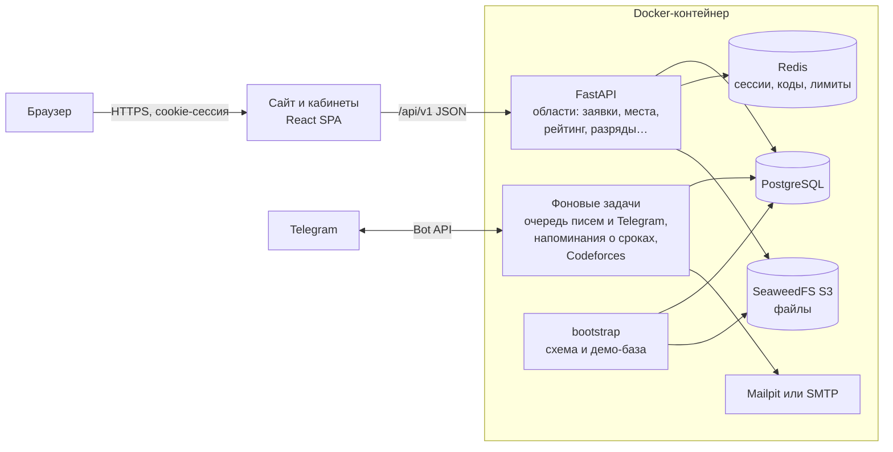
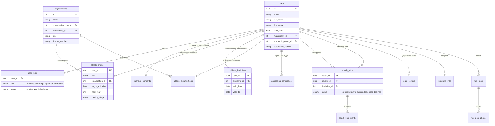
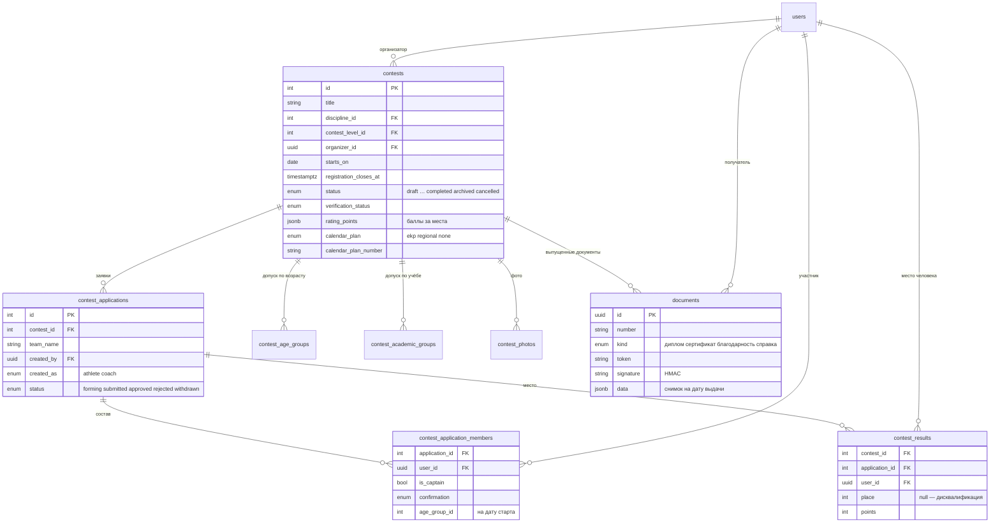
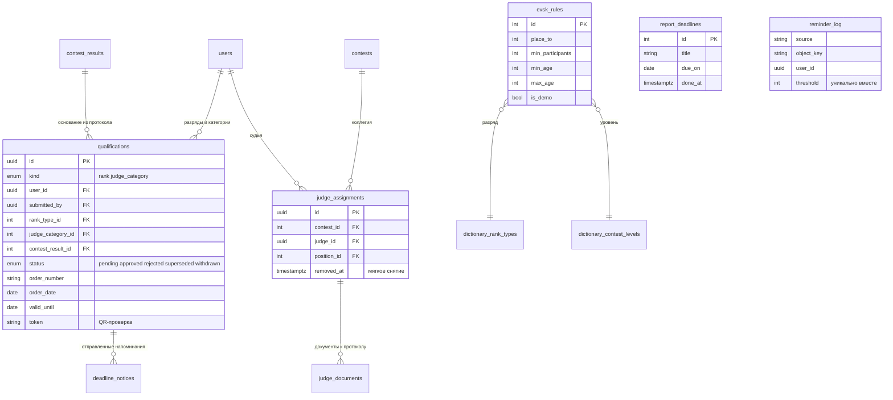
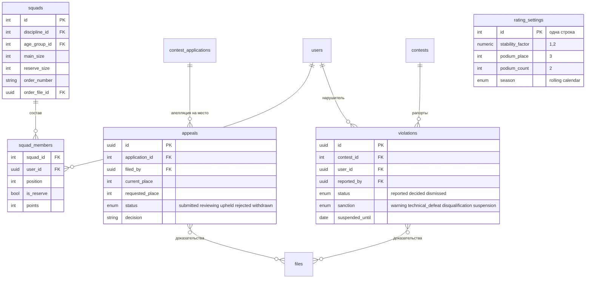
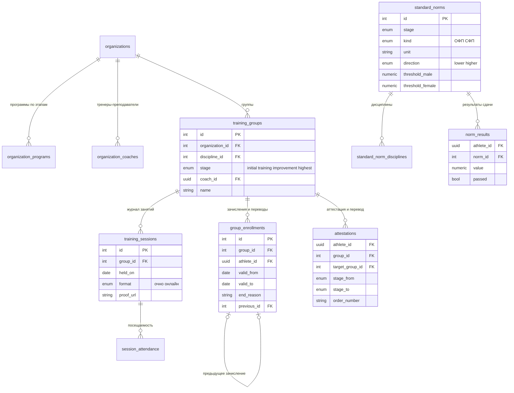

# Платформа ФСП Оренбургской области

Веб-платформа регионального отделения Федерации спортивного программирования для кейса хакатона «ОренКод — 2026». Сайт федерации и кабинеты пяти ролей: спортсмен, тренер, судья, организатор и сотрудник федерации. Через неё проходит весь путь: соревнование → заявка → места → протокол и документы → рейтинг и сборная → разряд по приказу. Попутно ведутся реестры, сроки и отчётность.

Все данные в демо вымышленные. Пароль всех демо-аккаунтов — **`Demo1234`**.

**Содержание**

1. [Концепция](#1-концепция)
2. [Быстрый старт для проверяющих](#2-быстрый-старт-для-проверяющих)
3. [Демо-аккаунты](#3-демо-аккаунты)
4. [Соответствие критериям оценки](#4-соответствие-критериям-оценки)
5. [Как проверить сценарии на стенде](#5-как-проверить-сценарии-на-стенде)
6. [Технический стек](#6-технический-стек)
7. [Архитектура](#7-архитектура)
8. [Области бэкенда](#8-области-бэкенда)
9. [Модель данных (ERD)](#9-модель-данных-erd)
10. [Карта API](#10-карта-api)
11. [Настройка: почта, Telegram, переменные окружения](#11-настройка-почта-telegram-переменные-окружения)
12. [Ограничения и что не сделано](#12-ограничения-и-что-не-сделано)
13. [Структура репозитория](#13-структура-репозитория)
14. [Тесты бэкенда](#14-тесты-бэкенда)
15. [Аудит соответствия ТЗ](#15-аудит-соответствия-тз)

---

## 1. Концепция

**Проблема.** Данные федерации разбросаны по таблицам и перепискам: один и тот же человек заведён несколько раз, протокол собирается вручную из заявок, сроки разрядов и категорий никто не отслеживает, рейтинг и отчёты считаются руками.

**Решение.** У каждого человека один аккаунт. На этот аккаунт навешиваются роли, каждая со своим кабинетом. Данные вводятся один раз и дальше переиспользуются:

- одобренная заявка сразу становится строкой протокола;
- внесённое место попадает в историю выступлений, рейтинг, документы участников и подсказки ЕВСК;
- место из протокола становится основанием заявки на разряд, а присвоенный разряд получает приказ, срок, напоминания и QR-проверку;
- периоды дисциплин и организаций в профиле дают отчёт о численности за любые годы.

**Принципы.**

- Решения принимает федерация, платформа готовит основания. Подсказка ЕВСК не присваивает разряд, а апелляция не меняет места без решения.
- Всё объяснимо. У рейтинга есть строка «45 + 40 + 0 = 85 × 1,2 = 102». Если спортсмена нет в рейтинге, кабинет называет причину. У отказа есть причина, у правки есть запись в журнале.
- Значимые действия попадают в журнал аудита в той же транзакции, что и само действие.
- Уведомления приходят в кабинет, на почту и в Telegram, а человек сам выбирает каналы.
- Документы выпускаются с номером и QR-кодом, подписанным HMAC. Подлинность проверяется на публичной странице без входа.

**Роли и кабинеты.**

| Роль | Что делает |
|---|---|
| Спортсмен | Профиль, запись на соревнования (лично и в команде), рейтинг, разряд и личный путь, документы, апелляции, сроки |
| Тренер | Связь со спортсменами по дисциплине, заявки за них, разряды подопечных, благодарности, апелляции |
| Судья | Категория и её срок, назначения в коллегии, документы к протоколу, рапорты о нарушениях |
| Организатор | Свои соревнования от черновика до архива, заявки, места, протокол, документы, чек-лист готовности |
| Сотрудник федерации | Модерация ролей и согласий, все соревнования и верификация, разряды и категории, реестр и численность, рейтинг и сборные, апелляции, аналитика, журнал, справочники, новости и события |

Тренер, судья, организатор и сотрудник федерации подтверждаются федерацией. У одного аккаунта может быть несколько ролей, переключение между ними происходит без повторного входа.

---

## 2. Быстрый старт для проверяющих

### Что нужно

| Что | Зачем |
|---|---|
| **Docker Desktop**: 4 ГБ памяти, около 4 ГБ диска | Бэкенд и все хранилища в одном контейнере |
| **Node.js 20+ и npm** — не обязательно | Сайт. Можно запустить и в Docker, см. вариант Б ниже |
| Свободные порты **8000, 9000, 8025, 5173** | API, хранилище файлов, почтовый ящик Mailpit, сайт |
| Интернет при первой сборке | Образы и пакеты |

Внешние сервисы и ключи не нужны: почта по умолчанию уходит во встроенный Mailpit, Telegram-бот необязателен.

### Шаг 1. Бэкенд

Из корня репозитория:

```bash
docker build -f manage/Dockerfile -t fsp .
docker run -d --name fsp -p 8000:8000 -p 9000:9000 -p 127.0.0.1:8025:8025 fsp
```

Первая сборка занимает 3–6 минут. После `docker run` контейнер ещё 30–60 секунд создаёт схему и заливает демо-базу. Готово, когда в логе появилась строка `demo data seeded`:

```bash
docker logs -f fsp
```

### Самый простой путь: один скрипт управляет всем проектом

```bash
python manage/fsp.py
```

Меню (стрелки и Enter или цифра) управляет и бэкендом, и сайтом:

| Пункт | Что делает |
|---|---|
| 1. Собрать / пересобрать | Собирает Docker-образ с нуля, затем во `frontend/` выполняет `npm install` и `npm run build` |
| 2. Запустить | Поднимает контейнер (API, хранилище, Mailpit), затем `npm install` и `npm run dev` — сайт на http://localhost:5173 в фоне |
| 3. Остановить | Гасит dev-сервер сайта и удаляет контейнер (данные сбрасываются) |

Переменные `FSP_*` из окружения скрипт передаёт в контейнер сам. Шаги ниже — то же самое вручную.

### Шаг 2. Сайт

**Вариант А — Node.js установлен:**

```bash
cd frontend
npm install
npm run dev
```

**Вариант Б — только Docker** (Linux и macOS; в PowerShell замените `$(pwd)` на `${PWD}`):

```bash
docker run -d --name fsp-front -p 5173:5173 -v "$(pwd)/frontend:/app" -w /app \
  -e VITE_PROXY_TARGET=http://host.docker.internal:8000 node:22-alpine \
  sh -c "npm install && npm run dev -- --host 0.0.0.0"
```

### Шаг 3. Открыть

| Что | Адрес |
|---|---|
| Сайт | http://localhost:5173 |
| Swagger (все эндпоинты с формами запросов) | http://localhost:8000/docs |
| Почтовый ящик Mailpit — все письма платформы | http://localhost:8025 |
| API | http://localhost:8000/api/v1 |

### Важно знать

- **База пересоздаётся при каждом старте контейнера.** Всё, что накликано руками, после `docker restart fsp` пропадает, а демо возвращается в исходное состояние. Так удобно повторять сценарии.
- **Даты демо считаются от сегодняшнего дня**: «регистрация открыта», «истекает через 5 дней», «идёт сейчас» остаются правдой в любой день.
- Порт **9000** обязателен: это хранилище файлов. Без него не откроются фото, положения и PDF.
- На Mac с Apple Silicon сборка идёт через эмуляцию amd64 и занимает больше времени.
- Остановить и удалить: `docker rm -f fsp fsp-front`.

---

## 3. Демо-аккаунты

Пароль у всех — **`Demo1234`**.

| Роль | Почта | Что посмотреть |
|---|---|---|
| Сотрудник федерации | `federation@example.test` | Все очереди, верификация, разряды и категории, реестр, рейтинг и правила, сборные, апелляции, аналитика, журнал. Владелец Telegram-бота |
| Сотрудник федерации | `minister@example.test` | Второй сотрудник, администратор бота |
| Организатор | `organizer@example.test` | Свои соревнования, заявки, места, протокол, документы, чек-лист готовности |
| Тренер | `coach@example.test` | Три подопечных (одна связь приостановлена) и Морозова. Заявки за спортсменов, разряды подопечных |
| Судья | `judge@example.test` | Категория истекает через 5 дней. Главный судья чемпионата и олимпиады по ИИ, рапорт о нарушении |
| Тренер и судья | `coach.judge@example.test` | Первая категория, главный судья ближайшего соревнования, ждёт ответа на запрос связи с Соколовым |
| Спортсмен и тренер | `athlete.coach@example.test` | Две роли у одного аккаунта |
| Спортсмен | `athlete@example.test` | Соколов: второй разряд с приказом и QR, заявка на первый, рейтинг 102 (пример кейса), курс РУСАДА истекает |
| Спортсмен, 17 лет | `athlete.second@example.test` | Морозова: согласие представителя на проверке, лидер рейтинга 14–17 лет |
| Спортсмен | `athlete.third@example.test` | Гусев: отстранён на 90 дней, поэтому нет в рейтинге и заявки не принимаются |
| Подопечные тренера | `pupil1@example.test`, `pupil2@example.test`, `pupil3@example.test` | Ковалёв (юношеский разряд, поданный тренером), Фёдорова, Ахмедов |
| Спортсменка, 14 лет | `athlete.minor@example.test` | Белова: приглашение в команду, удовлетворённая апелляция |
| Ожидают подтверждения | `organizer.pending@example.test`, `coach.unverified@example.test`, `judge.pending@example.test` | Роль на проверке, кабинет ограничен |
| Отказ в роли | `judge.rejected@example.test` | Видна причина отказа |

Ещё около 30 спортсменов на все сочетания возраста и академической группы, например `u14-1-4.1@example.test`, `14-17-10-11.5@example.test`, `18-stud.1@example.test`. Почта говорит о категории: `u14` — до 14 лет, `14-17` — 14–17 лет, `18` — 18 и старше; дальше идёт группа (`1-4`, `5-9`, `10-11` — классы, `stud` — студенты) и номер.

**Демо-данные.** Шесть организаций, 30+ соревнований на все дисциплины и статусы, история за два года для аналитики и численности. Вдобавок:

- судейские коллегии и документы судей;
- разряды и категории с приказами;
- две сборные по приказу;
- апелляции и нарушения во всех статусах;
- уведомления, новости и события.

---

## 4. Соответствие критериям оценки

Обозначения и веса — из «Критериев оценки ОренКод 2026». Пять критериев по 20 %, внутри критерия пункт оценивается от 0 до 3. Статус: **готово** — сценарий проходит до конца на данных платформы; **с оговоркой** — проходит, ограничение указано рядом. Как пройти каждый сценарий на стенде — в разделе 5 под тем же кодом.

### 4.1. Работоспособность прототипа — С1–С7

| Код | Сценарий | Вес | Статус | Как устроено |
|---|---|---:|---|---|
| С1 | Один аккаунт с несколькими ролями, переключение между кабинетами, права по активной роли | 8 | готово | Пять ролей, кабинет на каждую, переключение без повторного входа. Кабинет передаёт активную роль заголовком `X-Active-Role`, сервер сужает права запроса до неё: в кабинете спортсмена тренерские операции закрыты (403). Роль без подтверждения федерации выдать нельзя |
| С2 | Федерация создаёт и публикует соревнование: дисциплина, статус, тип из справочника, возрастная группа, календарный план, положение | 8 | готово | Все поля из справочников, которые ведёт федерация; уровень (региональное, межрегиональное, всероссийское), формат очно / онлайн / смешанный, ЕКП или КП области с номером и предупреждением о несовпадении с уровнем; положение PDF. Жизненный цикл от черновика до архива, чек-лист готовности из 11 пунктов |
| С3 | Заявка спортсмена или тренера, проверка возраста и дисциплины, модерация федерацией | 10 | с оговоркой | Личные и командные заявки, тренер подаёт за спортсменов. Сервер проверяет окно регистрации, возраст на дату старта по возрастным группам, академическую группу, согласие представителя, дубли, размер команды, отстранение. Федерация одобряет, отклоняет с причиной, возвращает, массово. Дисциплина задаётся выбором соревнования: заявка на дисциплину, которой нет в профиле спортсмена, не блокируется |
| С4 | Тренер привязывает спортсмена, спортсмен подтверждает | 5 | готово | Запрос с дисциплиной → принять или отклонить → приостановить, возобновить, завершить; история и уведомления. У спортсмена может быть несколько тренеров по разным дисциплинам |
| С5 | Федерация вносит результаты, протокол строится из одобренных заявок, результаты в истории спортсменов | 10 | готово | Места всех допущенных, дисквалификация, команда — одно место; протокол xlsx по форме с коллегией и документами судей; импорт протокола из xlsx или PDF; места сразу в ленте и отчёте спортсмена, рейтинге и документах |
| С6 | Коллегия, назначения судьи, срок категории, заявка на присвоение или подтверждение, рассмотрение | 10 | готово | Назначение только судьи с категорией, действующей на дату старта, конфликт интересов виден. «Моя категория» со сроком и напоминаниями, «Мои назначения». Заявка с документом, федерация присваивает или отказывает с причиной |
| С7 | Заявка на разряд с соревнованием и результатом, фиксация разряда, предупреждения об истечении спортсмену, тренеру и федерации | 10 | готово | Основание — место из протокола; присвоение с номером и датой приказа, срок по справочнику, QR-проверка. Напоминания за 30, 7 и 1 день и в день истечения уходят спортсмену, его тренерам по активной связи и федерации — в кабинет, на почту и в Telegram, без повторов |

### 4.2. Соответствие функциональным требованиям — С8–С10, Д3–Д12

| Код | Сценарий | Вес | Статус | Как устроено |
|---|---|---:|---|---|
| С8 | Реестр занимающихся и отчёт о динамике численности, .xlsx | 16 | готово | Реестр спортсменов, тренеров, судей и организаций с фильтрами по дисциплине, организации, разряду, возрастной группе, муниципалитету и этапу, выгрузка как на экране. Численность за любые годы (в демо — больше двух лет) без повторов человека, разрезы по организациям, дисциплинам, возрастным группам, муниципалитетам и этапам; книга xlsx по форме «Численность занимающихся спортивным программированием в Оренбургской области» |
| С9 | Рейтинг с фильтром по возрасту и прозрачным расчётом; сборная из рейтинга: список и проект приказа | 20 | готово | Рейтинг за сезон по дисциплинам и группам, баллы за места по уровню соревнования, коэффициент ×1,2 призёру двух соревнований, исключение отстранённых, фильтр «разряд не ниже». У каждого строка расчёта «45 + 40 + 0 = 85 × 1,2 = 102». Сборная: состав из рейтинга, федерация вручную исключает спортсменов (их место занимают следующие), PDF «Список сборной и проект приказа», утверждение приказом |
| С10 | Документы по формам: протокол, отчёт по спортсмену | 10 | готово | Протокол xlsx; отчёт по человеку за период в PDF и xlsx; дипломы, сертификаты, грамоты, благодарности и справки в PDF с номером и QR; реестры, численность и аналитика в xlsx |
| Д3 | Организации спортивной подготовки, группы и журнал занятий | 4 | готово | Карточка организации с программами и тренерами-преподавателями, группы по четырём этапам (зачисление, перевод, отчисление с историей), журнал очно и онлайн с подтверждением и посещаемостью, учёт в численности |
| Д4 | Нормативы и аттестация по ФССП | 5 | готово | 35 нормативов ОФП и СФП с печатью на клавиатуре из приказа Минспорта № 445 по этапу, дисциплине и полу; автоотметка «выполнен / нет», аттестационная ведомость и перевод на следующий этап |
| Д5 | Апелляции и фиксация нарушений | 3 | готово | Апелляция с доказательствами → рассмотрение → мотивированное решение с правкой протокола. Рапорт судьи → предупреждение, техническое поражение, дисквалификация или отстранение до даты; отстранённый выпадает из рейтинга и сборной, заявки не принимаются |
| Д6 | Показатели развития вида спорта в регионе | 3 | с оговоркой | Аналитика федерации (участники, соревнования, удержание, тренеры, судьи, сравнение периодов) и численность по годам. Отдельной публичной страницы показателей нет |
| Д7 | Личный путь спортсмена и справочник понятий | 2 | готово | Текущий разряд, следующая ступень, нормы ЕВСК, подходящие соревнования, «Подать» с местом из протокола; публичный справочник понятий с поиском |
| Д8 | Премии Губернатора | 3 | с оговоркой | Напоминание федерации о сроке ходатайств до 1 февраля. Отбора претендентов и сумм нет |
| Д9 | Кабинет министерства спорта | 2 | не делали | — |
| Д10 | Справка об участии с QR и проверкой подлинности | 2 | готово | Спортсмен сам получает справку; номер, QR с HMAC-подписью, публичная страница проверки без входа |
| Д11 | Навигатор для новичка | 2 | с оговоркой | Пошаговый навигатор по кабинету каждой роли, справочник понятий (как начать, как стать тренером или судьёй), календарь, регистрация. Раздела «где заниматься» нет |
| Д12 | Документы о судействе: справка о составе коллегии, отчёт по судье | 2 | готово | Справка о составе судейской коллегии с QR, справки о судействе, благодарности судьям, отчёт по человеку с разделом судейства |

### 4.3. Технологичность — Т1, Т2, Д1, Д2

| Код | Пункт | Вес | Что есть |
|---|---|---:|---|
| Т1 | Архитектура и код: модульность, API, защита ПД, README | 10 | Модульный монолит: 25 областей, в каждой слои эндпоинты → домен → хранилища (раздел 7). 339 эндпоинтов, OpenAPI и подробная карта с примерами ([API_DOCUMENTATION.md](API_DOCUMENTATION.md)). Права проверяются на сервере у каждого запроса, по активной роли. ПД: Argon2, HttpOnly-сессия, CSRF, приватные файлы, маска несовершеннолетних, согласия. **132 теста**: юнит, интеграционные, сквозные сценарии С1–С9, контрактные, безопасность, производительность (раздел 14). Конфигурация через переменные `FSP_*`, развёртывание одной командой Docker |
| Т2 | Структура данных: полнота, согласованность, валидация, демо-данные | 10 | 65 таблиц с внешними ключами, ограничениями и частичными уникальными индексами (раздел 9). Валидация Pydantic на входе и правила в домене. Демо по всем шести дисциплинам (плюс квизы), история за два года и больше: соревнования, заявки, места, разряды, группы, нормативы |
| Д1 | Региональный ФСП ID | 5 | не делали |
| Д2 | Интеграции с внешними системами | 5 | не делали; есть открытая спецификация OpenAPI и импорт протокола из xlsx или PDF |

### 4.4. Презентация — П3

| Код | Пункт | Что есть |
|---|---|---|
| П3 | UX и UI: стилистика ФСП, адаптивность, навигация, удобство | Свой набор компонентов по брендбуку ФСП, тёмная и светлая темы, вёрстка от 375 px. У каждого экрана с данными состояния загрузки, пустого списка с действием и ошибки с «Повторить». Навигатор по кабинету, справочник понятий, подсказки у полей, «Обзор» роли с очередями на решение, быстрые пути из уведомлений |

### 4.5. Потенциал — Р1, Р2

**Р1. Соответствие правилам вида спорта и процессам федерации.** Учтены возрастные и академические группы на дату старта, статусы и типы соревнований из справочников, уровни и календарные планы (ЕКП и КП области с номером), сроки разрядов и судейских категорий с напоминаниями, ЕВСК (подсказка претендентов по протоколу), этапы спортивной подготовки и нормативы ФССП, антидопинг РУСАДА, согласия представителей несовершеннолетних.

**Р2. Собственные сценарии команды** — работают на данных платформы:

| Сценарий | Польза для федерации |
|---|---|
| Telegram-бот с «Панелью федерации» | Уведомления с «Прочитано», свои заявки и подтверждение участия; федерации — решения по ролям кнопками, статистика, рассылка, три уровня администраторов |
| Объяснимый рейтинг и «Почему меня нет в рейтинге» | Строка расчёта у каждого, причины отсутствия в кабинете, правила рейтинга меняет федерация с записью в журнал |
| QR-проверка разряда и категории | Публичная страница без лишних ПД: ступень, приказ, срок, статус |
| Подсказки ЕВСК | «Может претендовать на разряд» в протоколе, очередь кандидатов, уведомление спортсмену и тренеру |
| Импорт протокола из xlsx или PDF | Сопоставление с одобренными заявками по ФИО и команде, ручной разбор сомнительных строк |
| Чек-лист готовности, конфликт интересов судьи, повтор заявки тем же составом | Меньше ошибок при подготовке соревнования |
| Отчёт по человеку, страница человека с лентой выступлений | PDF и xlsx за период; публичный профиль с постами и фото |
| Аналитика федерации | Участники, новички, удержание по когортам, тренеры, судьи, сравнение периодов, xlsx по блокам |
| Безопасность аккаунта | Коды на почту, смена почты, «вход с нового устройства», лимиты попыток |
| Привязка Codeforces, новости и события федерации | Рейтинг Codeforces в профиле, редактор статей, события в общем календаре |

---

## 5. Как проверить сценарии на стенде

Всё работает на демо-данных сразу после запуска, пароль у всех `Demo1234`. Соревнования ищите в «Соревнованиях» по названию.

**С1. Несколько ролей.** `athlete.coach@example.test` → «Сменить кабинет» вверху меню: «Спортсмен» и «Тренер» без повторного входа. В кабинете спортсмена тренерские разделы недоступны.

**С2. Соревнование.** `federation@example.test` → «Соревнования» → «Создать»: дисциплина, тип, уровень, формат, возрастная группа, календарный план и номер, положение PDF → «Опубликовать» → «Открыть регистрацию». «Готовность» на карточке — 11 пунктов.

**С3. Заявка и модерация.** `athlete@example.test` → «Соревнования» → открытый приём → «Подать заявку». `athlete.third@example.test` (отстранён) и спортсмен вне возрастной группы получают отказ с причиной. `federation@example.test` → «Соревнования» → «Заявки» на карточке: одобрить, отклонить с причиной, массово.

**С4. Привязка тренера.** `coach@example.test` → «Мои спортсмены» → «Привязать спортсмена» → дисциплина. `athlete@example.test` → «Профиль спортсмена» → запрос от `coach.judge@` → «Принять».

**С5. Результаты и протокол.** `federation@example.test` → «Командный CTF «Оренбургский рубеж»» (идёт сейчас) → «Места» → сохранить; «Протокол xlsx»; места появились у участников на странице человека, в рейтинге и документах. «Импорт протокола» принимает xlsx или PDF.

**С6. Судьи.** `federation@example.test` → карточка соревнования → «Судьи»: назначить, сменить должность, снять. `judge@example.test` → «Мои назначения», «Моя категория» (истекает через 5 дней, напоминание в уведомлениях) → «Подать заявку». Федерация → «Разряды и категории» → «Судейские категории».

**С7. Разряд.** `athlete@example.test` → «Мой разряд»: второй разряд с приказом и QR, заявка на первый. `coach@example.test` → «Разряды спортсменов» → «Подать за спортсмена» с местом из протокола. Федерация → «Присвоить» с номером и датой приказа. Предупреждения об истечении — в уведомлениях владельца, тренера и федерации.

**С8. Реестр и численность.** `federation@example.test` → «Реестр»: вкладки спортсменов, тренеров, судей с фильтрами и «xlsx»; «Численность» → разрезы → «Отчёт xlsx».

**С9. Рейтинг и сборная.** «Рейтинг» → «Алгоритмическое программирование» → «18 лет и старше»: у Соколова 102 = «45 + 40 + 0 = 85 × 1,2 = 102». Фильтры возрастной группы и «Разряд не ниже». Федерация → «Сборные» в шапке → «Утвердить»: состав из рейтинга, «Исключить» у спортсмена (его место займёт следующий), «Проект приказа и список, PDF», номер и PDF приказа → «Утвердить».

**С10. Документы.** Федерация → протокол xlsx соревнования. `athlete@example.test` → «Мои документы» → «Отчёт» за период в PDF или xlsx, «Получить справку».

**Д3, Д4.** `federation@example.test` → «Организации» → «СШ «Цифровой спорт»»: программы, тренеры, группы. `coach@example.test` → «Группы» → «УТ-2 · алгоритмика»: состав, журнал, «Нормативы и аттестация». Федерация → «Нормативы».

**Д5.** `federation@example.test` → «Апелляции и нарушения»: апелляция с логом PDF → «Взять на рассмотрение» → «Решить» с правкой мест; рапорт судьи → санкция. `14-17-10-11.5@example.test` → «Мои апелляции» → «Подать апелляцию».

**Д7, Д10, Д11, Д12.** `athlete@example.test` → «Мой разряд» → «Личный путь»; подвал сайта → «Справочник понятий». «Мои документы» → «Получить справку» → QR. Первый вход в роль — навигатор по кабинету. `organizer@example.test` → завершённый чемпионат → «Документы» → «Справка о составе судейской коллегии».

**Уведомления и журнал.** «Забыли пароль?» → код в Mailpit (http://localhost:8025). Кабинет → «Настройки» → каналы, «Отправить тестовое», «Привязать Telegram». Федерация → «Журнал действий»: каждое действие выше с полями «было / стало».

---

## 6. Технический стек

### Бэкенд

| Технология | Версия | Зачем и почему |
|---|---|---|
| Python | 3.12 | Типизация, быстрый старт команды, зрелая экосистема для PDF и xlsx |
| FastAPI | 0.115 | Асинхронный API, проверка входных данных через Pydantic, Swagger из коробки — это и есть описание API для проверяющих |
| Pydantic / pydantic-settings | 2.11 / 2.9 | Схемы запросов и ответов, конфигурация из переменных окружения `FSP_*` |
| SQLAlchemy (async) + asyncpg | 2.0 / 0.30 | ORM с типами, асинхронный драйвер Postgres, транзакция на запрос через UnitOfWork |
| PostgreSQL | из Debian (в образе) | Основное хранилище. Частичные уникальные индексы держат правила вроде «одна открытая заявка», «одна действующая квалификация» |
| Redis | из Debian (в образе) | Сессии, лимиты попыток входа и сброса пароля, одноразовые коды, счётчики просмотров |
| SeaweedFS (S3 API) + клиент `minio` | 4.51 / 7.2 | Файлы: положения, фото, приказы, согласия, доказательства. Публичный и приватный бакеты, подписанные ссылки. Выбран вместо MinIO: community-сборки MinIO больше не распространяются |
| Argon2 (`argon2-cffi`) | 23.1 | Хеширование паролей |
| WeasyPrint + Jinja2 | 66 / 3.1 | PDF документов и отчётов по HTML-шаблонам в оформлении ФСП |
| openpyxl | 3.1 | Протокол, реестры, численность, аналитика и отчёт в xlsx |
| segno | 1.6 | QR-коды в PDF |
| httpx | 0.28 | Telegram Bot API и Codeforces API |
| Mailpit | 1.32 | Локальный почтовый ящик: все письма видны без настройки SMTP |
| Uvicorn | 0.34 | ASGI-сервер |

### Фронтенд

| Технология | Версия | Зачем и почему |
|---|---|---|
| React | 19 | Интерфейс кабинетов и сайта |
| TypeScript (strict) | 6 | Типы API и компонентов, ошибки ловятся на сборке |
| Vite | 8 | Сборка и dev-сервер с прокси `/api` на бэкенд |
| Tailwind CSS | 4 | Стили через токены дизайн-системы: две темы, палитра брендбука ФСП. Цвета Tailwind по умолчанию отключены |
| React Router | 7 | Маршруты сайта и кабинетов, фильтры хранятся в адресе |
| TanStack Query | 5 | Кэш запросов, инвалидация после действий, «Показать ещё» по offset |
| clsx | 2 | Склейка классов |
| Шрифты | JetBrains Mono, Roboto | Как на сайте ФСП: моно для заголовков и чисел |

Сторонних UI-библиотек нет: набор компонентов свой, около 50 штук — таблицы, окна, поля, метки, графики, QR. Все компоненты в обеих темах собраны на странице `/design` в режиме разработки.

### Качество и запуск

| Что | Как |
|---|---|
| Проверка типов бэкенда | Pyright |
| Фронтенд | `tsc -b` в strict, ESLint, в том числе правило направления импортов между слоями, Prettier |
| Ошибки API | Единый формат `{"error": {"code", "message", "fields"}}`, ошибки полей показываются у самих полей |
| Безопасность | Cookie-сессия `sid` (HttpOnly), CSRF-токен в заголовке `X-CSRF-Token`, роли проверяются на сервере у каждого эндпоинта, приватные файлы доступны только загрузившему и федерации |
| Поставка | Один Docker-образ: API, PostgreSQL, Redis, SeaweedFS и Mailpit поднимаются одной командой |

---

## 7. Архитектура

Модульный монолит: один процесс FastAPI, внутри — независимые предметные области. Хранилища и фоновые задачи живут в том же контейнере, поэтому запуск — одна команда, а внешние сервисы не нужны.



**Как устроена область.** Каждая область бэкенда (`applications`, `ratings`, `disputes` и так далее) разложена по слоям, импорт идёт только вниз:

| Слой | Отвечает за |
|---|---|
| `features` | Эндпоинты и схемы запросов/ответов; проверка роли |
| `domain` | Правила предметной области, транзакция, запись в журнал, уведомления |
| `repositories` | Запросы к Postgres (`pg_`), Redis (`red_`), файловому хранилищу (`s3_`) — без решений |
| `clients` | Внешние сервисы: SMTP, Telegram Bot API, Codeforces |

Модели базы лежат отдельно (`infrastructure/`), по одной таблице на файл, сгруппированы так же, как области.

**Ключевые решения.**

- **Транзакция и побочные эффекты вместе.** Действие, запись в журнал и уведомление сохраняются одной транзакцией. Письма и сообщения в Telegram не отправляются из запроса, а кладутся в таблицу-очередь `outbox`. Фоновый воркер отправляет их с повторами, поэтому сбой почты не ломает действие.
- **Напоминания без повторов.** Наблюдатель сроков раз в час проверяет пороги. Каждое отправленное напоминание фиксируется уникальной записью, поэтому даже при нескольких экземплярах дубля не будет.
- **Пересчёт вместо копий.** Рейтинг считается на лету из мест верифицированных соревнований по текущим правилам. После правки протокола (вручную, по апелляции или по санкции) рейтинг, документы и подсказки ЕВСК сразу актуальны.
- **Документы с проверкой.** У каждого документа и присвоенного разряда есть номер, токен и HMAC-подпись. Публичная страница проверки показывает минимум данных: ФИО сокращённо, вид, срок, статус.
- **Даты по Оренбургу.** «Сегодня» и границы дней считаются в часовом поясе `Asia/Yekaterinburg`, а окно регистрации проверяется по серверному времени.
- **Демо как код.** Схема создаётся из моделей при каждом старте. Данные заливаются из `manage/seed/seed.sql` с датами от `current_date`, а документы выпускает код приложения — у них настоящие номера и подписи.

**Фронтенд** построен по Feature-Sliced Design: `app → pages → widgets → features → entities → shared`, импорт только вниз и через публичный `index.ts` слоя (проверяет ESLint). Формы открываются в модальных окнах, списки показываются таблицами с поиском и фильтрами в адресе. У каждого экрана с данными четыре состояния: загрузка, пусто, ошибка, данные.

---

## 8. Области бэкенда

| Группа | Область | Что делает |
|---|---|---|
| Основа | `core` | Конфиг, подключения, единый формат ошибок, проверка здоровья |
| Аккаунт | `auth` | Регистрация, вход, сессии, роли и их подтверждение, почта и коды, восстановление пароля |
| | `people` | Страница человека, лента выступлений, Codeforces |
| | `consents` | Согласия законных представителей и их проверка |
| Общие службы | `audit` | Журнал действий |
| | `files` | Загрузка с проверкой типа по содержимому, публичная и подписанная выдача |
| Справочники | `dictionaries` | 11 справочников: чтение, добавление, правка, архив |
| Соревнования | `contests` | Каталог, кабинеты организатора и федерации, жизненный цикл, верификация с баллами, календарный план |
| | `events` | События федерации и общая лента календаря |
| Участие и итоги | `applications` | Личные и командные заявки, приглашения, подача тренером, повтор состава, модерация, допуск |
| | `results` | Места, протокол xlsx, импорт протокола из xlsx или PDF |
| | `documents` | Дипломы, сертификаты, грамоты, благодарности, справки: PDF и проверка по QR |
| | `readiness` | Чек-лист готовности соревнования |
| | `disputes` | Апелляции и нарушения, санкции, отстранение |
| | `ratings` | Рейтинг по правилам федерации, объяснение итога, «почему меня нет» |
| | `squads` | Сборные по приказу |
| Судьи и разряды | `qualifications` | Разряды и категории, приказ, QR, судейские коллегии, документы судей |
| | `evsk` | Правила ЕВСК, претенденты на разряд, личный путь |
| Спортивная подготовка | `profiles` | Организации, спортивный профиль, связи тренер ↔ спортсмен, РУСАДА |
| | `training` | Программы и тренеры организаций, учебно-тренировочные группы, журнал занятий, нормативы ФССП, аттестация |
| | `registry` | Реестр федерации и численность занимающихся |
| | `deadlines` | Сроки по ролям и фоновые напоминания |
| Контент | `news` | Новости и редактор статей |
| Уведомления | `notifications` | Кабинет, настройки каналов, очередь писем и Telegram, Telegram-бот |
| Аналитика и отчёты | `analytics` | Дашборд федерации и xlsx |
| | `reports` | Отчёт по человеку в PDF и xlsx |

---

## 9. Модель данных (ERD)

65 таблиц. Ниже — фрагменты по смыслу, у таблиц показаны только ключевые поля. Справочники (`dictionary_*`: дисциплины, муниципалитеты, типы организаций, возрастные и академические группы, типы, уровни и форматы соревнований, разряды, судейские категории и должности) у всех одинаковые: `id`, `name`, `description`, `is_archived`, плюс поля по смыслу (возрастные границы, срок действия разряда).

### 9.1. Аккаунт и спортивная подготовка



### 9.2. Соревнования, участие и документы



### 9.3. Судьи, разряды, ЕВСК и сроки



### 9.4. Рейтинг, сборные, апелляции и нарушения



### 9.5. Спортивная подготовка: программы, группы, журнал, нормативы



**Служебные таблицы:**

| Таблица | Что хранит |
|---|---|
| `files` | Файл в хранилище: ключ, тип, размер, публичность, кто загрузил |
| `audit_log` | Журнал действий: кто, что, объект, изменения, IP |
| `notifications` | Уведомления в кабинете |
| `outbox` | Очередь писем и сообщений Telegram с повторами |
| `notification_settings` | Отключённые каналы по группам уведомлений |
| `telegram_links` | Привязка Telegram к аккаунту |
| `bot_admins` | Администраторы бота и их уровень |
| `news_articles` | Новости |
| `calendar_events` | События федерации |

---

## 10. Карта API

Всего 339 эндпоинтов, база `/api/v1`. Ниже — краткая сводка по разделам. **Подробная карта — [API_DOCUMENTATION.md](API_DOCUMENTATION.md):** у каждого эндпоинта доступ, параметры с ограничениями, поля тела запроса, пример запроса и пример ответа (для GET — настоящий ответ демо-стенда). Интерактивно — Swagger: http://localhost:8000/docs.

**Общие правила API:**

- Сессия — cookie `sid`. Для изменяющих запросов значение cookie `csrf_token` передаётся в заголовке `X-CSRF-Token`.
- Ошибки приходят в виде `{"error": {"code": "...", "message": "...", "fields": {"поле": ["..."]}}}`. Коды HTTP:
  - 401 — нужен вход;
  - 403 — нет прав;
  - 404 — нет объекта или он скрыт;
  - 409 — конфликт состояния: `invalid_status`, `appeal_exists` и другие;
  - 422 — ошибки полей.
- Списки отдаются как `{items, total}` с параметрами `limit` и `offset`.

**Кто вызывает** (колонка «Кто»):
- **все** — без входа;
- **вошедший** — любая роль;
- **спортсмен**, **тренер**, **судья**, **организатор** — конкретная роль;
- **федерация** — сотрудник федерации. Пути `/admin/*` — только федерация, `/organizer/*` — только организатор.

### Аккаунт и роли

| Метод | Путь | Кто | Назначение |
|---|---|---|---|
| POST | `/auth/register`, `/auth/login`, `/auth/logout` | все | Регистрация, вход, выход |
| POST | `/auth/password/forgot` → `/verify` → `/reset` | все | Восстановление пароля кодом из письма |
| GET, PATCH | `/me` | вошедший | Профиль аккаунта: ФИО, дата рождения, группа, муниципалитет |
| POST | `/me/roles`, `/me/roles/{role}/onboarding` | вошедший | Запросить роль, заполнить данные роли |
| POST | `/me/email/verify/send`, `/me/email/verify`, `/me/email/change`, `/me/email/change/confirm` | вошедший | Подтверждение и смена почты кодом |
| GET, PUT | `/me/guardian-consent` | спортсмен до 18 | Согласие представителя |
| GET | `/admin/role-requests`, `/admin/role-requests/counts` | федерация | Очередь заявок на роли |
| POST | `/admin/role-requests/{id}/approve` · `reject` · `reset` | федерация | Решение по роли |
| GET | `/admin/guardian-consents`, `/admin/guardian-consents/count` | федерация | Очередь согласий |
| POST | `/admin/guardian-consents/{id}/approve` · `reject` | федерация | Решение по согласию |

### Люди, профиль, тренеры, организации

| Метод | Путь | Кто | Назначение |
|---|---|---|---|
| GET | `/people/{id}`, `/people/{id}/avatar`, `/people/{id}/wall` | все | Страница человека, фото, лента выступлений |
| PATCH, PUT | `/me/page`, `/me/wall/{role}/{contest_id}` | вошедший | Видимость страницы, пост к соревнованию |
| PATCH | `/admin/wall-posts/{id}` | федерация | Скрыть или вернуть пост |
| PUT, DELETE | `/me/codeforces` | вошедший | Хэндл Codeforces |
| GET, PUT | `/me/sport-profile` | спортсмен | Спортивный профиль |
| POST, DELETE | `/me/antidoping`, `/me/antidoping/{id}` | спортсмен | Курс РУСАДА |
| GET | `/me/coach-links`, `/coach-links/candidates`, `/coach-links/{id}` | тренер, спортсмен | Связи, поиск спортсмена, история связи |
| POST | `/coach-links`, `/coach-links/{id}/{accept·decline·suspend·resume·end}` | тренер, спортсмен | Запрос и смена статуса связи |
| GET | `/organizations` | все | Поиск организаций |
| GET, POST, PATCH | `/admin/organizations`, `/admin/organizations/{id}` | федерация | Справочник организаций |
| GET | `/admin/registry/{athletes·coaches·judges}` и `.xlsx` | федерация | Реестр с фильтрами и выгрузкой |
| GET | `/admin/registry/headcount` и `.xlsx` | федерация | Численность по годам и отчёт, разрез по этапам, группы как источник |
| GET | `/organizations/{id}`, `/admin/organizations/{id}` | все, федерация | Карточка: программы, тренеры, группы |
| POST, DELETE | `/admin/organizations/{id}/programs`, `/admin/organizations/{id}/coaches` | федерация | Программы подготовки и тренеры-преподаватели |
| GET, POST, PATCH | `/training/groups`, `/training/groups/{id}` | тренер, федерация | Учебно-тренировочные группы |
| POST | `/training/groups/{id}/enrollments`, `/training/enrollments/{id}/transfer` · `expel` | тренер, федерация | Зачисление, перевод, отчисление |
| GET, POST, PUT, DELETE | `/training/groups/{id}/sessions`, `/training/sessions/{id}` | тренер, федерация | Журнал занятий |
| GET | `/norms`, `/admin/norms` | все, федерация | Нормативы ФССП; POST, PATCH — правка федерацией |
| POST | `/training/norm-results` | тренер, федерация | Результаты сдачи с автоотметкой |
| GET, POST | `/training/groups/{id}/attestation`, `/training/attestations` | тренер, федерация | Ведомость и итог аттестации |
| GET | `/training/athletes/{id}/enrollments` · `attendance` · `norms` | сам, тренер, федерация | Группы, посещаемость, нормативы и аттестации |

### Справочники

| Метод | Путь | Кто | Назначение |
|---|---|---|---|
| GET | `/dictionaries`, `/dictionaries/{key}` | все | Список справочников и значения |
| GET, POST | `/admin/dictionaries/{key}` | федерация | Все записи с архивом, добавление |
| PATCH, DELETE | `/admin/dictionaries/{key}/{id}` | федерация | Правка, удаление неиспользуемой записи |
| POST | `/admin/dictionaries/{key}/{id}/archive` · `restore` | федерация | Архив и восстановление |

Ключи справочников: `disciplines`, `municipalities`, `organization_types`, `academic_groups`, `age_groups`, `contest_types`, `contest_levels`, `contest_formats`, `rank_types`, `judge_categories`, `judge_positions`.

### Соревнования и календарь

| Метод | Путь | Кто | Назначение |
|---|---|---|---|
| GET | `/contests`, `/contests/{id}` | все | Каталог с фильтрами и сортировкой, карточка |
| GET, POST | `/organizer/contests`, `/admin/contests` | организатор, федерация | Свои или все соревнования, создание |
| GET, PATCH, DELETE | `/organizer/contests/{id}`, `/admin/contests/{id}` | организатор, федерация | Соревнование |
| POST | `…/contests/{id}/publish` · `unpublish` · `open-registration` · `close-registration` · `start` · `complete` · `archive` · `cancel` | организатор, федерация | Жизненный цикл |
| POST | `/organizer/contests/{id}/request-verification` | организатор | Запросить верификацию |
| POST | `/admin/contests/{id}/verify` · `reject-verification` · `revoke-verification` | федерация | Верификация с баллами за места |
| GET, PATCH | `/admin/contests/rating-points-defaults`, `/admin/contests/{id}/rating-points` | федерация | Баллы за места |
| GET | `/contests/{id}/readiness` | организатор, федерация | Чек-лист готовности |
| GET | `/calendar/events`, `/calendar/events/{id}` | все | Общая лента соревнований и событий; фильтры `discipline_id`, `online`, `mine=true` (нужен вход) |
| GET, POST, PATCH | `/admin/calendar/events`, `/admin/calendar/events/{id}`, `…/{id}/{action}` | федерация | Ведение событий |

### Заявки

| Метод | Путь | Кто | Назначение |
|---|---|---|---|
| GET | `/contests/{id}/participants` | все | Одобренные участники |
| GET | `/me/available-contests`, `/me/applications`, `/athletes/search` | спортсмен, тренер | Куда можно записаться и почему нельзя, свои заявки, поиск спортсмена |
| POST | `/contests/{id}/applications` · `/batch` · `/repeat` | спортсмен, тренер | Заявка, пачка личных заявок тренером, повтор состава |
| GET, PATCH | `/applications/{id}` | участник, автор | Заявка, название команды |
| POST, DELETE | `/applications/{id}/members`, `/applications/{id}/members/{user_id}` | автор | Состав команды |
| POST | `/applications/{id}/submit` · `withdraw` · `confirm` · `decline` | автор, участник | Подать, отозвать, подтвердить или отказаться |
| GET | `/{organizer·admin}/applications/contests`, `/{organizer·admin}/contests/{id}/applications` | организатор, федерация | Модерация заявок |
| POST | `/{organizer·admin}/applications/{id}/approve` · `reject` · `reset`, `…/applications/approve` · `reject` (массово) | организатор, федерация | Решения по заявкам |

### Места, протокол, рейтинг, сборные

| Метод | Путь | Кто | Назначение |
|---|---|---|---|
| GET | `/contests/{id}/results` | все | Места соревнования |
| GET, PUT | `/{organizer·admin}/contests/{id}/results` | организатор, федерация | Форма мест и сохранение |
| GET | `/{organizer·admin}/contests/{id}/results/protocol.xlsx` | организатор, федерация | Протокол xlsx |
| POST | `/{organizer·admin}/contests/{id}/results/import` | организатор, федерация | Импорт протокола из xlsx или PDF: предпросмотр сопоставления |
| GET | `/ratings`, `/ratings/table` | все | Рейтинги по дисциплинам и группам, фильтры муниципалитета и минимального разряда, строка объяснения |
| GET | `/ratings/settings`, `/ratings/athletes/{id}` | все | Правила рейтинга, положение спортсмена |
| GET | `/ratings/me` | вошедший | Своё место и причины отсутствия |
| PUT | `/admin/ratings/settings` | федерация | Коэффициент, порог призёров, сезон |
| GET | `/squads`, `/squads/members/{user_id}` | все | Действующие сборные, метки на странице человека |
| GET | `/admin/squads/candidates` | федерация | Кто войдёт в сборную при утверждении; `exclude_ids` — ручное исключение |
| GET | `/admin/squads/order-draft.pdf` | федерация | Список сборной и проект приказа, PDF |
| POST, DELETE | `/admin/squads`, `/admin/squads/{id}` | федерация | Утвердить по приказу, расформировать |

### Документы и отчёты

| Метод | Путь | Кто | Назначение |
|---|---|---|---|
| GET | `/contests/{id}/documents`, `/contests/{id}/documents/{kind}/pdf` | все | Выпущенные документы соревнования |
| GET | `/documents/{token}`, `/documents/{token}/pdf` | все | Проверка документа по QR, PDF |
| GET | `/me/documents` | вошедший | Свои документы |
| POST | `/me/documents/reference` | спортсмен | Получить справку об участии |
| PUT, DELETE | `/{organizer·admin}/contests/{id}/documents/{kind}` | организатор, федерация | Выпустить или убрать документы вида |
| GET | `/{organizer·admin}/contests/{id}/documents/{kind}/preview` | организатор, федерация | Предпросмотр |
| GET | `/people/{id}/report`, `/people/{id}/report.pdf`, `/people/{id}/report.xlsx` | сам человек, тренер, федерация | Отчёт по человеку за период |

### Судьи, разряды, ЕВСК

| Метод | Путь | Кто | Назначение |
|---|---|---|---|
| GET | `/me/qualifications`, `/me/athletes`, `/me/qualification-results` | вошедший | Свои разряды и категории, спортсмены тренера, места для основания |
| POST | `/qualifications`, `/qualifications/{id}/withdraw` | спортсмен, тренер, судья | Заявка на разряд или категорию, отзыв |
| GET | `/verify/qualifications/{token}` | все | Проверка разряда или категории по QR |
| GET | `/admin/qualifications`, `/admin/qualifications/{id}/preview` | федерация | Очередь, срок при одобрении |
| POST | `/admin/qualifications/{id}/approve` · `reject` | федерация | Присвоить с номером и датой приказа, отказать |
| GET | `/contests/{id}/judges`, `/contests/{id}/judges/candidates` | все; организатор, федерация | Коллегия, кандидаты с конфликтами интересов |
| POST, PATCH, DELETE | `/contests/{id}/judges`, `/contests/{id}/judges/{assignment_id}` | организатор, федерация | Назначить, сменить должность, снять |
| GET | `/me/judge-assignments` | судья | Свои назначения |
| GET, POST | `/contests/{id}/judge-documents` | все; судья коллегии | Документы коллегии |
| PATCH, DELETE | `/judge-documents/{id}` | автор | Заменить или удалить свой документ |
| GET, POST, PATCH, DELETE | `/admin/evsk/rules`, `/admin/evsk/rules/{id}` | федерация | Правила ЕВСК |
| GET | `/admin/evsk/candidates`, `/contests/{id}/evsk` | федерация; организатор | Претенденты на разряд по протоколам |
| GET | `/me/path` | спортсмен | Личный путь к следующему разряду |

### Апелляции и нарушения

| Метод | Путь | Кто | Назначение |
|---|---|---|---|
| GET | `/contests/{id}/disputes` | вошедший | Апелляции и нарушения в пределах прав, свои заявки для апелляции |
| POST | `/contests/{id}/appeals`, `/appeals/{id}/withdraw` | участник, автор заявки, тренер участника | Подать и отозвать апелляцию |
| POST | `/contests/{id}/violations` | судья коллегии, федерация | Рапорт о нарушении |
| GET | `/me/disputes` | вошедший | Свои апелляции и решения по нарушениям |
| GET | `/me/appealable` | вошедший | Где можно подать апелляцию сейчас: свои заявки и заявки подопечных с открытым сроком |
| GET | `/admin/disputes` | федерация | Очередь |
| POST | `/admin/appeals/{id}/review` · `decide` | федерация | Рассмотрение и решение с правкой мест |
| POST | `/admin/violations/{id}/decide` | федерация | Санкция или закрытие рапорта |

### Сроки, уведомления, журнал, аналитика, файлы, новости

| Метод | Путь | Кто | Назначение |
|---|---|---|---|
| GET | `/me/deadlines` | вошедший | Сроки на 60 дней |
| GET, POST, PATCH, DELETE | `/admin/report-deadlines`, `/admin/report-deadlines/{id}`, `/admin/report-deadlines/governor` | федерация | Отчётные сроки, премии Губернатора |
| GET, POST | `/notifications`, `/notifications/unread-count`, `/notifications/read-all`, `/notifications/{id}/read` | вошедший | Уведомления в кабинете |
| GET, PUT | `/me/notification-settings` | вошедший | Каналы по группам |
| GET, POST, DELETE | `/me/telegram`, `/me/telegram/link`, `/me/notifications/test` | вошедший | Привязка Telegram, тест доставки |
| GET, POST, PATCH, DELETE | `/admin/telegram/admins`, `/admin/telegram/admins/{user_id}` | федерация | Администраторы бота |
| GET | `/admin/audit`, `/admin/audit/catalog` | федерация | Журнал действий и фильтры |
| GET | `/admin/analytics/{block}`, `/admin/analytics/{block}.xlsx`, `/admin/analytics.xlsx` | федерация | Блоки аналитики и выгрузка |
| POST | `/files` | вошедший | Загрузка файла (JPEG, PNG, WebP, PDF, DOCX, XLSX, ZIP до 10 МБ) |
| GET | `/files/{id}` | по правам | Скачивание приватного файла |
| GET | `/news`, `/news/tags`, `/news/{slug}` | все | Новости |
| GET, POST, PATCH | `/admin/news`, `/admin/news/{id}`, `/admin/news/{id}/{action}` | федерация | Редактор и публикация |
| GET | `/health` | все | Проверка здоровья |

---

## 11. Настройка: почта, Telegram, переменные окружения

Всё необязательно: без настроек платформа работает полностью, письма уходят в Mailpit.

| Переменная | По умолчанию | Что задаёт |
|---|---|---|
| `FSP_TELEGRAM_BOT_TOKEN` | нет | Токен бота от @BotFather. Без него бот не запускается, в «Настройках» видно, что он не подключён |
| `FSP_SMTP_HOST`, `FSP_SMTP_PORT`, `FSP_SMTP_TLS_MODE` (`none`/`starttls`/`ssl`), `FSP_SMTP_USERNAME`, `FSP_SMTP_PASSWORD`, `FSP_SMTP_SENDER` | Mailpit внутри контейнера | Настоящая почта |
| `FSP_FRONTEND_URL` | `http://localhost:5173` | Адрес сайта для ссылок в письмах и Telegram |
| `FSP_S3_PUBLIC_URL` | `http://localhost:9000` | Откуда браузер берёт публичные файлы; меняйте, если пробрасываете хранилище на другой порт |
| `FSP_DOCUMENT_SIGNING_SECRET` | демо-секрет | Ключ HMAC-подписи документов и разрядов; в продакшене обязательно свой |

Переменные передаются в `docker run` через `-e`. Если задать их в окружении хоста, `python manage/fsp.py` передаст их сам. Пример с реальной почтой (Яндекс, пароль приложения):

```bash
docker run -d --name fsp -p 8000:8000 -p 9000:9000 -p 127.0.0.1:8025:8025 \
  -e FSP_SMTP_HOST=smtp.yandex.ru -e FSP_SMTP_PORT=465 -e FSP_SMTP_TLS_MODE=ssl \
  -e FSP_SMTP_USERNAME=box@yandex.ru -e FSP_SMTP_PASSWORD=<пароль приложения> \
  -e "FSP_SMTP_SENDER=ФСП Оренбург <box@yandex.ru>" \
  -e FSP_TELEGRAM_BOT_TOKEN=<токен> fsp
```

Секреты в репозиторий и файлы `.env` не кладутся.

---

## 12. Ограничения и что не сделано

- **Нормы ЕВСК — демо.** Официальных норм по спортивному программированию в открытых источниках не нашлось. Правила помечены «демо», федерация заменяет их в интерфейсе.
- **Протокол без версий.** Правка мест (вручную, по апелляции, по санкции) перезаписывает места и перевыпускает документы. Основание правки остаётся в журнале, но прежняя версия протокола как отдельный документ не хранится.
- **Связь тренера при заявке** не проверяется: тренер может записать любого спортсмена, а участие подтверждает сам спортсмен. Дисциплина профиля спортсмена при заявке тоже не сверяется.
- **Сборная** собирается из рейтинга с ручным исключением; добавить спортсмена вне рейтинга нельзя. Проект приказа — PDF, подписанный приказ загружается файлом.
- **Не реализованы** Д1, Д2, Д9 и части Д6, Д8, Д11 — подробности в разделе 4.2.
- **Миграций нет.** Схема создаётся из моделей при каждом старте, база демо пересоздаётся. Для продакшена нужны миграции (Alembic) и отдельные хранилища.
- **Сайт в режиме разработки.** Фронтенд запускается dev-сервером Vite. Для продакшена — `npm run build` и раздача `frontend/dist` веб-сервером с прокси `/api` на бэкенд.

---

## 13. Структура репозитория

```
backend/          API на FastAPI: области по слоям features → domain → repositories/clients (см. backend/README.md)
infrastructure/   ORM-модели, по таблице на файл, по группам (см. infrastructure/README.md)
manage/           Docker-образ, старт контейнера, демо-база seed.sql и файлы к ней (см. manage/README.md)
frontend/         React-приложение по Feature-Sliced Design (см. frontend/README.md)
API_DOCUMENTATION.md  подробная карта API с примерами
backend/tests/    юнит- и интеграционные тесты бэкенда
```

---

## 14. Тесты бэкенда

132 теста в `backend/tests/` на pytest, шесть видов:

| Вид | Файл | Что проверяет |
|---|---|---|
| Юнит | `test_unit_rules.py` (33) | Доменные правила без базы: формула рейтинга и пример 102, округление, сезон; места подряд, сдвиг мест при санкциях; пороги напоминаний и срок премий; возраст и границы групп; HMAC-подпись разряда; маска ИНН; периоды численности; план по уровню |
| Интеграционные | `test_api_access.py`, `test_api_competition_flow.py`, `test_api_rating_ranks.py`, `test_api_disputes_profile.py`, `test_api_training.py` | Права по ролям (401, 403), CSRF, валидация (422), формат ошибок, приватные файлы, маска несовершеннолетних; каталог, допуск, места, протокол, QR документов; рейтинг, разряды, ЕВСК, реестр, численность; апелляции, профиль, сроки; группы, нормативы, справка о коллегии |
| Сквозные сценарии | `test_e2e_scenarios.py` | С1–С9 целиком через API: создание и публикация соревнования, заявка и модерация, отказ по возрасту, места → протокол → история, привязка тренера, судьи, разряд с местом и приказом → QR, исключение из сборной и PDF проекта приказа, права по активной роли, предупреждение федерации об истечении |
| Контрактные | `test_contract_security.py::TestContract` | У каждой операции OpenAPI есть раздел, название и описание; изменяющие операции объявляют CSRF; каждый эндпоинт описан в `API_DOCUMENTATION.md`; формат ошибок; дымовой прогон всех GET без 5xx |
| Безопасность | `test_contract_security.py::TestSecurity` | SQL-инъекции и XSS в поиске, выход из сессии, подменённый CSRF, чужая роль в `X-Active-Role`, файл с подменённым типом, чужая заявка, отсутствие хешей в ответах, блокировка подбора пароля (429) |
| Производительность | `test_contract_security.py::TestPerformance` | Публичные списки быстрее 2 с, отчёты федерации быстрее 3 с на демо-данных |

**Запуск.** Юнит-тесты работают без базы. Остальным нужен поднятый стенд (раздел 2) с чистой демо-базой — перезапустите контейнер перед прогоном (`docker restart fsp`). Если стенд не отвечает, эти тесты пропускаются, а не падают.

```bash
python -m venv .venv
.venv/bin/pip install -r backend/requirements.txt -r backend/requirements-dev.txt
cd backend
../.venv/bin/python -m pytest                                              # всё: стенд на http://localhost:8000
FSP_TEST_API=http://localhost:8100/api/v1 ../.venv/bin/python -m pytest   # стенд на другом порту
../.venv/bin/python -m pytest tests/test_unit_rules.py                      # только юнит-тесты
```

На Windows путь к интерпретатору — `.venv\Scripts\python.exe`.

---

## 15. Аудит соответствия ТЗ

Полный отчёт — [AUDIT_COMPLIANCE_REPORT.md](AUDIT_COMPLIANCE_REPORT.md): каждый пункт критериев (С1–С10, Д1–Д12, Т1–Т2, П3, Р1–Р2) и требования безопасности трассированы до файлов и строк, с разбором оговорок и планом доработок.

- **Обязательные сценарии С1–С10:** 9 готово, С3 — с оговоркой (дисциплина профиля при заявке не сверяется).
- **Дополнительные Д1–Д12:** готово Д3, Д4, Д5, Д7, Д10, Д12; с оговоркой Д6, Д8, Д11; не делали Д1, Д2, Д9.
- **Заглушек в серверной логике нет.** Секретов в репозитории и его истории нет.
- **Перед промышленным запуском:**
  1. Задать свои секреты: подпись документов и `Secure` у cookie.
  2. Проверять связь тренера и дисциплину при заявке.
  3. Перейти на миграции Alembic вместо пересоздания схемы.
  4. Раздавать собранный фронтенд через веб-сервер.
